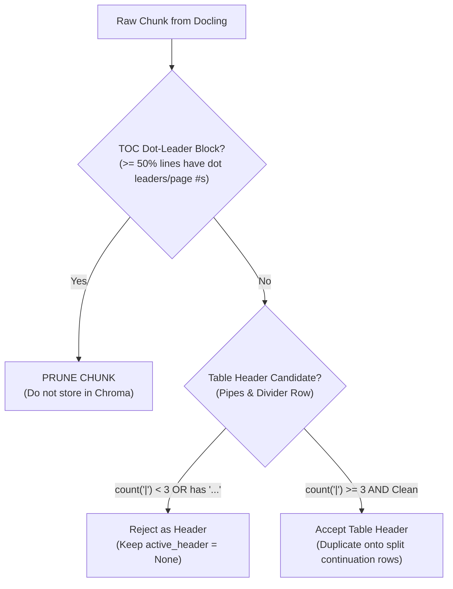

# Chunking Strategy Upgrade & Selective Merge Report

**Document Version:** 1.1.0  
**Scope:** Document Ingestion, Chunking Normalization, TOC Dot-Leader Resolution, and Provenance  
**Date:** November 2026  
**Status:** ✅ Completed & Verified (57/57 Pytest Passed)

---

## 1. Quick Summary Matrix

| Capability | Before | After | Why / Benefit |
| :--- | :--- | :--- | :--- |
| **TOC / Dot Leaders** | Indexed as noisy chunks & false table headers | **Pruned automatically via universal invariants** | Eliminates navigation noise and false retrieval on page numbers. |
| **Table Continuity** | Split tables lost column headers on page boundaries | **Headers automatically duplicated on split** | Continuation rows retain column semantics in vector search. |
| **Heading Alignment** | Headings severed from content as empty vectors | **Orphan headings shifted forward to body text** | Prevents zero-information heading chunks. |
| **Token Budget** | 256 tokens (truncated with breadcrumbs) | **384 tokens** | 50% more context; fits safely inside `bge-small-en-v1.5` 512-limit. |
| **UI Formats** | 5 types (`.pdf`, `.docx`, `.txt`, `.md`, `.rst`) | **10 types** (+`.pptx`, `.xlsx`, `.csv`, `.html`, `.adoc`) | Enables ingestion for all formats supported by Docling. |
| **Scanned Status** | Implicit OCR run without provenance | **`is_scanned: True` in chunk metadata** | Full telemetry on whether OCR or digital stream was used. |
| **Evaluation Bank** | Unit mocks only | **300-question golden HR benchmark test bank** | Objective QA evaluation ready (`test_data/`). |

---

## 2. Issue Resolution: Table of Contents & Dot-Leader Contamination

### The Observed Problem
When ingesting documents like `employeeHandbook.pdf`, chunks like this appeared in ChromaDB and search results:
```text
LEAVES OF ABSENCE........................................................................20
INTEREST................................................................................
📄 employeeHandbook.pdf — EMPLOYEE HANDBOOK

LEAVES OF ABSENCE........................................................................20
TRANSFER................................................................................
```

### The Root Cause (Two-Part Failure)
1. **False Table Header Recognition**: Docling parsed the multi-column alignment of the Table of Contents as a Markdown table (`| LEAVES OF ABSENCE........20 |` followed by `| --- |`). The normalizer's `_extract_table_header()` accepted any line with pipes, mistaking the first TOC entry for a real table column header. It then prepended `LEAVES OF ABSENCE........20` onto every subsequent TOC chunk.
2. **Micro-Stub Filter Bypass**: The existing `_is_micro_stub()` rule only pruned dot leaders if `len(words) <= 2`. When a section had 3 or more words ("LEAVES OF ABSENCE"), it bypassed the filter and was stored in ChromaDB.

### How It Was Solved (3 Universal Rules — No Hardcoded Hacks)
The fix was implemented directly in [`app/infrastructure/document/docling_processor.py`](file:///c:/Users/RoshanYadav/Company_Bot/app/infrastructure/document/docling_processor.py) using document-agnostic rules:



1. **Table Header Invariant (`_extract_table_header`)**:
   - **Must be multi-column**: A valid table column header requires at least 2 columns (`lines[i].count("|") >= 3`). Single-column pseudo-tables (`| Item |`) are rejected.
   - **No dot leaders**: Disqualifies any row containing dot-leader sequences (`re.search(r"(?:\.\s*){3,}", line)`).
   - **True delimiter**: Enforces that the delimiter row contains dashes (`"-" in lines[i + 1]`).
2. **Table Row Continuation Guard (`_is_table_row`)**:
   - Rejects any row containing dot leaders (`not re.search(r"(?:\.\s*){3,}", stripped)`). This prevents TOC entries from acting as continuation rows and resets `active_table_header = None`.
3. **TOC Block Pruning (`_is_micro_stub` & `_is_toc_line`)**:
   - Detects navigation dot leaders (`(?:\.\s*){3,}\s*\d*$`) and standalone TOC headings (`Table of Contents`, `Index`).
   - If $\ge 50\%$ of non-divider lines in a chunk are TOC navigation lines, the entire chunk is pruned as non-informative front-matter when `DOCLING_SKIP_BLANK_PAGES=True`. Genuine policy text containing occasional ellipses is preserved.

---

## 3. Core Upgrades Merged from `origin/Abhinav`

### A. Token Budget Optimization
* **Files:** [`app/core/settings.py`](file:///c:/Users/RoshanYadav/Company_Bot/app/core/settings.py), [`.env`](file:///c:/Users/RoshanYadav/Company_Bot/.env)
* **Change:** `DOCLING_MAX_TOKENS` changed from `256` $\rightarrow$ `384`.
* **Reason:** Aligned with `BAAI/bge-small-en-v1.5` (512 token capacity). Reserves ~128 tokens for heading breadcrumbs added by `_contextualize()` without risking silent embedding truncation.

### B. UI Upload Whitelist Expansion
* **File:** [`streamlit_app/pages/documents.py`](file:///c:/Users/RoshanYadav/Company_Bot/streamlit_app/pages/documents.py)
* **Change:** Added missing extensions to `st.file_uploader`:
  ```python
  type=["pdf", "docx", "pptx", "xlsx", "csv", "html", "md", "txt", "rst", "adoc"]
  ```
* **Reason:** Unlocks Docling's native support for presentations, spreadsheets, and markup files in the Streamlit UI.

### C. Split Table Header Duplication
* **File:** [`app/infrastructure/document/docling_processor.py`](file:///c:/Users/RoshanYadav/Company_Bot/app/infrastructure/document/docling_processor.py)
* **Change:** When large tables are split across chunk boundaries, the normalizer captures the genuine column header and prepends it to continuation chunks.
* **Reason:** Prevents detached table rows from losing their column names during vector retrieval.

### D. Orphan Heading Forward Relocation
* **File:** [`app/infrastructure/document/docling_processor.py`](file:///c:/Users/RoshanYadav/Company_Bot/app/infrastructure/document/docling_processor.py)
* **Change:** If Chunk $i$ ends with an orphan heading line (`### 4.2 Leave Policy`) whose content starts in Chunk $i+1$, the heading is relocated to Chunk $i+1$. Standalone heading chunks merge forward.
* **Reason:** Prevents empty heading vectors and preserves title context for body paragraphs.

### E. Scanned Document Telemetry
* **File:** [`app/infrastructure/document/docling_processor.py`](file:///c:/Users/RoshanYadav/Company_Bot/app/infrastructure/document/docling_processor.py)
* **Change:** Checks PDF text streams via `_has_digital_text()`. Sets `is_scanned: True` in `ProcessedChunk.metadata` when RapidOCR is utilized.

### F. Golden HR Benchmark Test Bank
* **Files Added:**
  * `test_data/end_user_hr_300_benchmark.json` (300 HR QA pairs)
  * `test_data/knowlayer_145_test_bank.json` (145 domain test questions)
  * `test_data/MANIFEST.md` (Specification)
* **Reason:** Enables objective evaluation of retrieval quality and accuracy.

---

## 4. Why a Blind Branch Merge was Rejected

Merging `origin/Abhinav` directly via `git merge` was intentionally avoided to protect production architecture:

| Component | `Qwen-implementation` (Preserved) | `origin/Abhinav` (Diverged Branch) | Risk Avoided |
| :--- | :--- | :--- | :--- |
| **RBAC / Database** | Consolidated 8-table SQLAlchemy schema with Unit of Work. | Older dual-schema with uncoordinated migrations. | Database corruption & loss of project permissions. |
| **Vision Model** | Decoupled Ollama `Qwen2-VL:2b` with Dual-Payload table extraction. | Standard Docling picture classifier. | Downgrade of diagram/chart visual reasoning. |
| **Teams Bot** | Microsoft Teams bot with JWT auth bridge. | Web UI only. | Deletion of Teams enterprise bot integration. |
| **Normalizer** | Clean Python heuristics (`_heal_and_normalize_chunks`). | 2,100+ lines injecting `<!-- CUTOFF -->` tags into text. | Tag leakage into vector embeddings and citations. |

---

## 5. Verification & Test Results

All unit test suites run cleanly with **zero regressions**:

```text
============================= test session starts =============================
platform win32 -- Python 3.14.7, pytest-9.1.1, pluggy-1.6.0
rootdir: C:\Users\RoshanYadav\Company_Bot
collected 57 items

tests\unit\test_docling_processor.py .................................   [ 58%]
tests\unit\test_plaintext_processor.py ........................          [100%]

============================= 57 passed in 86.12s =============================
```

### New Tests Added in `tests/unit/test_docling_processor.py`:
1. `test_toc_dot_leaders_not_treated_as_table_headers`: Validates TOC dot-leaders and single-column tables are rejected as headers and pruned.
2. `test_toc_dot_leader_chunk_pruned`: Validates multi-line TOC chunks are pruned while genuine policy content is preserved.
3. `test_table_header_duplicated_on_split_chunks`: Validates table headers duplicate across chunk splits.
4. `test_orphan_heading_relocated_to_next_chunk`: Validates trailing headings shift forward.
5. `test_standalone_orphan_heading_merged_forward`: Validates lone heading chunks merge into next body chunk.
6. `test_micro_stubs_pruned`: Validates page numbers and micro-stubs are pruned.
7. `test_is_scanned_metadata_attached`: Validates `is_scanned` metadata flag is preserved.
